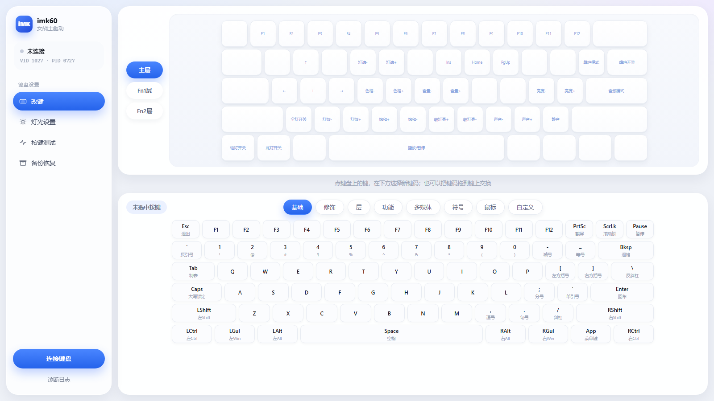
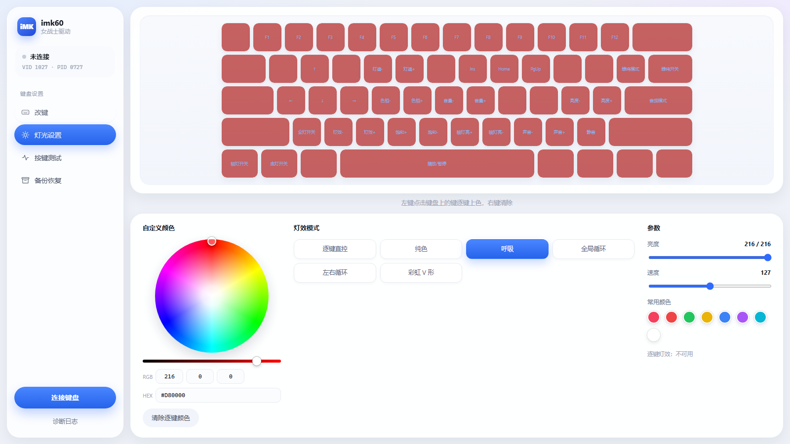

# imk60 女战士驱动（第三方）

面向 **iMK60 / 女战士 61 键** 的网页版键盘配置工具。纯本地运行，浏览器通过 WebHID 直接和键盘的 Vial 固件通信，不装驱动、不刷固件。

> 非官方项目，与 imk / Matrix Lab 无关，仅为个人使用需要而写。使用风险自负。


## 功能

| 模块 | 说明 |
| --- | --- |
| **改键** | 61 键真实配列，中文键码库可搜索，点选/拖拽改键，层切换，Ctrl+Z 撤销 |
| **高级键** | Tap Dance / 组合键 / 键改写 / 重复键（读写 Vial 动态条目） |
| **灯光** | 灯效切换、亮度、速度、色相色轮，本地动画预览；逐键上色；底灯（装饰灯）分栏 |
| **蜂鸣器** | 总开关、按键音（clicky） |
| **按键测试** | 矩阵轮询 + 系统按键事件双通道，按下实时高亮 |
| **备份恢复** | 连接时自动备份全部层，可一键回写 |

| 改键 | 灯光 |
| --- | --- |
|  |  |

## 运行

1. 安装 **Python 3.8+**（安装时勾选 `Add python.exe to PATH`）
2. 双击 **`启动.bat`**
3. 浏览器会自动打开 `http://127.0.0.1:8766/`
4. 点「立即连接」→ 选择 `imk60` → 授权

> 必须用 **Chrome / Edge**（需要 WebHID）。Firefox、Safari 不支持。
> 服务只监听 `127.0.0.1`，不对外网开放。

## 目录结构

```
.
├─ 启动.bat              # 一键启动（推荐）
├─ app/                  # 配置工具本体
│  ├─ index.html
│  ├─ app.css / app.js   # 界面与逻辑
│  ├─ keycodes.js        # 键码表
│  ├─ keyboard.json      # 键盘定义（由 probe 解出，LZMA → JSON）
│  ├─ product.jpg        # 设备卡片配图
│  └─ server.py          # 本地静态服务 + 备份接口
├─ probe/                # 只读探针：抓取固件里的键盘定义
│  ├─ index.html         # 探针页面（WebHID）
│  ├─ server.py / decode.py
│  └─ 启动探针.bat
└─ docs/screenshots/
```

## 原理

键盘固件实现了 VIA v9 + Vial v6 的 raw HID 协议（`usagePage 0xFF60 / usage 0x61`，32 字节报文）：

- 键位：`0x12 / 0x13` 读写动态键位缓冲，`0x05` 写单键
- 灯效：`0x08 / 0x07` + vialrgb 子命令（`0x40..0x44`）
- 高级键：`0xFE 0x0D` 动态条目（Tap Dance / 组合键 / 键改写 / 重复键）
- 键盘定义：`0xFE 0x02` 分页读取，内容是 LZMA 压缩的 JSON，用 `probe/decode.py` 解开

固件没有提供的能力（例如底灯分组效果）无法绕过，界面上会写清楚限制。

## 免责声明

- 本项目与键盘厂家无任何关联，不代表官方。
- 只会写入键位、灯效等运行时配置，**不会刷写固件**。
- 仍建议首次使用前用「备份」保存一份；误操作可通过「恢复」回滚。

## License

见仓库根目录 `LICENSE`。
